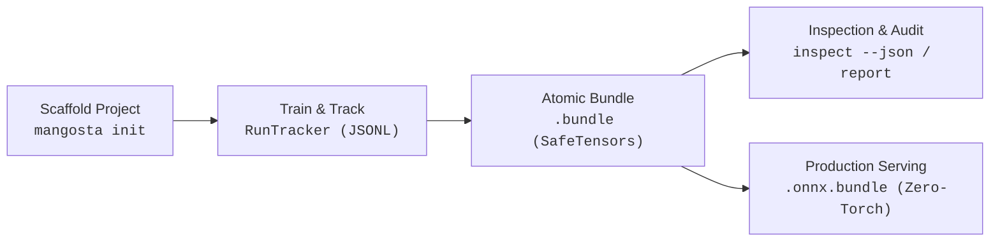

# mangosta

**Lightweight MLOps and Model Lifecycle Management for PyTorch.**

> *"Simple by default, strict on demand"* — Instant setup for rapid solo experimentation, yet engineered with the architectural rigor required by production pipelines and autonomous AI coding agents: formal tensor contracts, deterministic fault tolerance, zero-daemon persistence, and machine-readable CLI interfaces.

[](https://www.python.org/downloads/)
[](https://opensource.org/licenses/MIT)
[](https://github.com/astral-sh/ruff)
[](https://mypy-lang.org/)

---

## Why Mangosta?

Modern MLOps stacks frequently impose overwhelming operational complexity: background daemons, external database engines, cloud platform lock-in, and fragile networking.

`mangosta` is engineered to provide **local-first, serverless model lifecycle primitives** directly within Python and standard file systems. It eliminates infrastructure overhead while delivering strict guarantees regarding reproducibility, tensor contracts, and crash-consistent persistence.



### Architectural Principles

- **Zero Service Dependencies**: No background daemons, Redis, or databases. Everything is stored in human-readable, crash-consistent flat files (JSONL, standard ZIP archives, SafeTensors).
- **Zero-Pickle Security**: Weights are serialized exclusively using Hugging Face SafeTensors (`model.safetensors`). Arbitrary code execution during deserialization is physically impossible.
- **Contract-Driven Inference**: Non-invasive tensor signatures validate shapes (including dynamic batch dimensions) and data types before runtime execution.
- **Deterministic Bit-to-Bit Resumption**: Captures complete training snapshots (optimizer, scheduler, GradScaler, and RNG states across PyTorch CPU/CUDA, Python, and NumPy).
- **Slim Production Serving**: Deploy high-performance ONNX microservices (`~70MB` Docker containers) without installing PyTorch (`~2.5GB`).
- **AI Agent-Native**: Machine-readable `mangosta inspect <bundle> --json` parses SafeTensors binary headers in `< 5ms` with zero tensor allocations, perfectly tailored for LLMs and CI/CD pipelines.

---

## Technical Comparison

| Capability | **mangosta** | **Vanilla PyTorch** | **MLflow** | **Weights & Biases** |
| :--- | :--- | :--- | :--- | :--- |
| **Operational Overhead** | **Zero** (Local files only) | None | Local/Remote server | Cloud daemon / SaaS |
| **External Dependencies** | **None** (Self-contained) | None | Web server + DB | API backend |
| **Persistence Mechanism** | **Atomic JSONL & ZIP** | Ad-hoc `.pt` / `.pth` | SQLite / File store | Cloud storage |
| **Pickle Security** | **100% SafeTensors (Zero Pickle)** | Vulnerable (`pickle`) | Ad-hoc (usually pickle) | Ad-hoc (usually pickle) |
| **Deterministic RNG Recovery** | **Native** (CPU, CUDA, NumPy, Py) | Manual code required | None (manual) | None (manual) |
| **Tensor Contract Validation** | **Native** (Pre-inference) | Manual assertions | Model signatures | None |
| **Machine-Readable CLI** | **`--json` in < 5ms** | None | Limited CLI | CLI client |
| **Slim Microservice Image** | **~70MB (Zero-PyTorch)** | ~2.5GB - 6GB | ~2.5GB - 6GB | ~2.5GB - 6GB |
| **100% Offline Capability** | **Yes** | Yes | Partial | Offline queue mode |

---

## Installation

Install using `uv` (recommended):

```bash
uv add mangosta
```

Or using standard `pip`:

```bash
pip install mangosta
```

### Optional Bundles

- **ONNX Model Checker**:
  ```bash
  pip install "mangosta[onnx]"
  ```
- **Zero-PyTorch Slim Serving (Production microservices)**:
  ```bash
  pip install "mangosta[serving]"
  ```
- **Full Development Suite**:
  ```bash
  pip install "mangosta[dev]"
  ```

---

## 3-Minute Quickstart

### 1. Scaffold a Clean Architecture Project

```bash
mangosta init my_project
cd my_project
```

Scaffolds a modular Clean Architecture project with `configs/`, `src/`, `entrypoints/`, and `.agents/mangosta.md`.

### 2. Register Architecture & Track Training

```python
import torch
import torch.nn as nn
from mangosta import register_model, RunTracker, save_bundle

# 1. Register model architecture with semantic versioning
@register_model(family="sensor_mlp", version="1.0.0")
class SensorMLP(nn.Module):
    def __init__(self, in_features: int = 8, num_classes: int = 2) -> None:
        super().__init__()
        self.fc = nn.Linear(in_features, num_classes)

    def forward(self, x: torch.Tensor) -> torch.Tensor:
        return self.fc(x)

model = SensorMLP()
optimizer = torch.optim.Adam(model.parameters(), lr=1e-3)

# 2. Track experiment with atomic local flushing
with RunTracker(experiment="sensor_exp", run_name="baseline") as run:
    run.log_params({"lr": 1e-3, "batch_size": 32})

    for epoch in range(5):
        # Simulated loss
        run.log_metric("train/loss", 0.42 / (epoch + 1), step=epoch)

        # Log real validation sample for visual inspection in mangosta view (Input vs GT vs Pred)
        run.log_validation_sample(
            sample_id="sample_01",
            prediction=torch.rand(3, 32, 32),
            input_image=torch.rand(3, 32, 32),
            step=epoch,
        )

    # 3. Save atomic SafeTensors bundle with contract and checkpoint state
    save_bundle(
        output_path="checkpoints/epoch_5.bundle",
        model=model,
        sample_input=torch.randn(1, 8),
        optimizer=optimizer,
        epoch=5,
    )
```

### 3. Inspect in Terminal or Browser

```bash
# Human-readable terminal summary
mangosta inspect checkpoints/epoch_5.bundle

# Machine-readable JSON summary for AI agents or CI/CD
mangosta inspect checkpoints/epoch_5.bundle --json

# Launch zero-daemon local visual dashboard (Ctrl+C stops cleanly)
mangosta view
```

### 4. Zero-PyTorch Production Serving

Export the bundle to ONNX:

```bash
mangosta export-onnx checkpoints/epoch_5.bundle -o exports/model.onnx.bundle --input-shape 1 8 -m src.models.classifier
```

Serve in production without installing PyTorch:

```python
from mangosta import ONNXRunner
import numpy as np

# Requires only `mangosta[serving]` (~70MB container)
runner = ONNXRunner("exports/model.onnx.bundle")

# Automated tensor shape & dtype validation
features = np.random.randn(4, 8).astype(np.float32)
predictions = runner.predict(features)
```

---

## Command Line Interface (CLI)

| Command | Description |
| :--- | :--- |
| `mangosta init [name]` | Scaffold a production-grade Clean Architecture project. |
| `mangosta inspect <bundle>` | Inspect internal bundle contents, tensor layers, and signatures. |
| `mangosta inspect <bundle> --json` | Fast (<5ms) zero-torch JSON inspection for AI agents & CI/CD. |
| `mangosta view [target] [--port 8501]` | Start the ephemeral local visual dashboard (Real Data Timelapse, A/B/GT grid, Multi-Run Compare, EMA smoothing, SafeTensors inspector, Live Watch). |
| `mangosta report <target> [-o report.html]` | Generate a self-contained, offline interactive HTML report. |
| `mangosta export-onnx <bundle> -o <out>` | Export bundle directly to standalone ONNX or `.onnx.bundle`. |

---

## Documentation & Guides

- **User Guides**:
  - [Guide 1: Fast Prototyping for Solo Researchers](docs/guides/01_fast_prototyping.md)
  - [Guide 2: Fault Tolerance & Deterministic Resumption](docs/guides/02_fault_tolerance_and_resumption.md)
  - [Guide 3: Production Serving & Tensor Contracts](docs/guides/03_production_serving_and_contracts.md)
  - [Guide 4: Autonomous AI Agents & Machine-Readable CLI](docs/guides/04_ai_agents_and_cli.md)
- **API Reference**:
  - [`mangosta.tracking` (RunTracker, quick_track)](docs/api/tracker.md)
  - [`mangosta.artifacts` (save_bundle, load_bundle, resume_training)](docs/api/artifacts.md)
  - [`mangosta.core.schema` (ModelSchema, TensorSpec, infer_schema)](docs/api/schema.md)
  - [`mangosta.serving` (ONNXRunner, load_onnx_bundle)](docs/api/serving.md)
  - [`mangosta.core.registry` (ModelRegistry, @register_model)](docs/api/registry.md)
  - [`mangosta.export` (export_onnx)](docs/api/export.md)

---

## AI Agent Integration (Antigravity & Cursor Skill)

`mangosta` includes a native Agent Skill specification at [`skills/mangosta/SKILL.md`](skills/mangosta/SKILL.md). When copied to `.agents/skills/mangosta/SKILL.md` in your projects, AI assistants (Cursor, Claude Code, Antigravity) automatically follow defensive patterns:
- Always registering architectures with `@register_model`.
- Using `save_bundle` and `resume_training` instead of unsafe `pickle`/`torch.save`.
- Querying bundle metadata via `mangosta inspect <bundle> --json` to prevent token waste.

---

## Verification & Testing

Verify the test suite and static type checks locally:

```bash
# Run complete test suite with coverage (>85%)
pytest -v --cov=mangosta

# Run strict PEP 561 static type checks
mypy --config-file pyproject.toml src/mangosta

# Offline test suite (zero network)
bash scripts/test_offline.sh

# Slim serving test (zero PyTorch container)
bash scripts/test_slim_serving.sh
```

---

## License

MIT License. See [LICENSE](LICENSE) for details.
