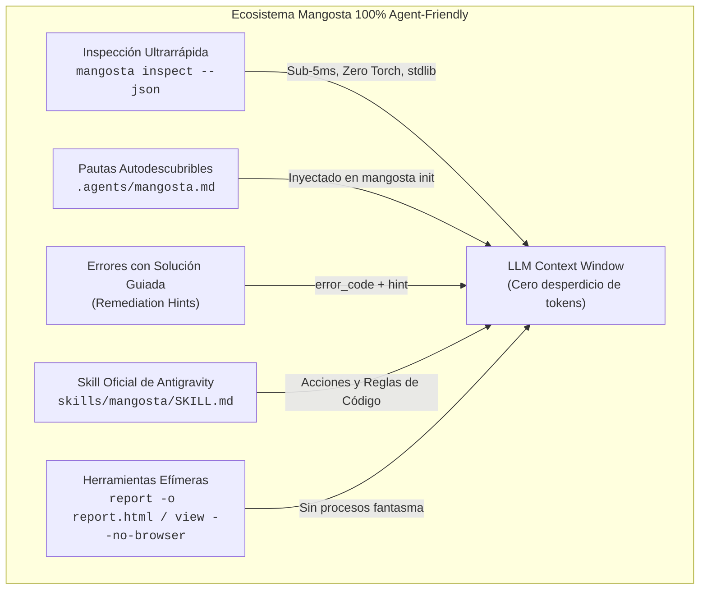

# Plan Maestro de Documentación para la Versión Estable de Mangosta

> **Estado:** Propuesta de Planificación (Planning Mode)  
> **Objetivo:** Diseñar y estructurar la documentación integral para el lanzamiento estable (v1.0.0) de `mangosta`, destacando su filosofía artesanal, visión de ingeniería, capacidad 100% amigable con Agentes de Inteligencia Artificial (Agent-Friendly), guías de instalación y tutoriales prácticos con código ejecutable.

---

## 1. Filosofía y Visión de Mangosta

### 1.1 La Filosofía: "Simple by default, strict on demand"
Mangosta nace como respuesta al agotamiento generado por el "complejo industrial de MLOps": sistemas que requieren daemons en segundo plano, servidores Postgres/Redis, dependencias frágiles de red, formatos `.pt` inseguros basados en `pickle`, y herramientas que secuestran el flujo de trabajo del desarrollador.

Mangosta se rige bajo los siguientes principios innegociables:
1. **La Filosofía Unix en MLOps**:
   - *Los archivos planos son la base de datos*: Un archivo `metrics.jsonl` es legible por humanos, inmune a corrupciones por caída repentina de energía, y compatible con `grep`, `awk` y herramientas estándar de terminal.
   - *El ZIP estándar es el paquete*: Los artefactos `.bundle` son archivos ZIP estándar que cualquier ingeniero puede descomprimir o inspeccionar con herramientas nativas de su sistema operativo.
2. **Cero Daemons en Segundo Plano (Zero-Daemon)**:
   - Nada corre en segundo plano sin permiso. `mangosta view` es un servidor HTTP efímero basado puramente en la biblioteca estándar de Python (`http.server`), sin dependencias de Node.js, CDN externas ni daemons huérfanos.
   - `mangosta report` genera un archivo `report.html` autónomo interactivo sin necesidad de ningún servidor web activo.
3. **Seguridad Absoluta (Zero-Pickle)**:
   - Desterrar `pickle` para el almacenamiento de pesos. Los modelos se guardan exclusivamente en Hugging Face SafeTensors (`model.safetensors`). Es matemáticamente imposible ejecutar código arbitrario al cargar un bundle.
4. **Resumabilidad Determinista Bit-a-Bit**:
   - Reanudar un entrenamiento no debe aproximar el estado aleatorio: debe recuperar exactamente los generadores de números pseudoaleatorios (RNG) de PyTorch (CPU y CUDA), NumPy y Python estándar.
5. **Contratos Formales No Invasivos**:
   - Validación estricta de tensores en inferencia (`ModelSchema`, `TensorSpec`) con soporte para lotes dinámicos (`None`), detectando discrepancias de forma o tipo antes de ejecutar cualquier cómputo costoso.

### 1.2 La Visión: ¿Qué se construye con Mangosta?
Mangosta aspira a ser el cimiento estándar para equipos de Machine Learning, laboratorios de investigación y empresas que valoran la **autonomía**, la **reproducibilidad científica** y el **despliegue desacoplado**:
- **Laboratorios de Investigación**: Experimentos locales auditables, trazabilidad de datasets mediante hashes criptográficos SHA-256 e interoperabilidad sin conexión a Internet (air-gapped).
- **Equipos de Producción**: Despliegue de microservicios ultraligeros de inferencia ONNX en contenedores Docker de `~70MB` con **cero dependencias de PyTorch**, reduciendo costos de infraestructura y tiempos de arranque en frío.
- **Flujos Autónomos de IA**: Un ecosistema diseñado desde el primer día para ser operado directamente por modelos de lenguaje y agentes de código autónomos.

---

## 2. El Pilar "100% Agent-Friendly": ¿Por Qué Mangosta es Nativo para Agentes?

Las herramientas tradicionales de MLOps fueron pensadas exclusivamente para humanos mirando navegadores web. Para un Agente de IA (Antigravity, Cursor, Claude Code, GitHub Copilot), son hostiles:
- Consumen miles de tokens imprimiendo tablas con caracteres ANSI y cajas ASCII decorativas.
- Requieren levantar servicios web o sockets que el agente no puede supervisar fácilmente.
- Para inspeccionar un checkpoint, obligan a importar `torch` (pesado, lento y con riesgo de OOM en GPU).

Mangosta invierte esta relación y ofrece una experiencia **100% amigable para agentes**:



### Características Técnicas del Soporte Agent-Friendly:
1. **Inspección Binaria en Sub-5 Milisegundos (`mangosta inspect <bundle> --json`)**:
   - Extrae capas, formas de tensores y tipos leyendo directamente la cabecera little-endian binaria de SafeTensors (`struct.unpack("<Q")`) mediante la biblioteca estándar de Python.
   - No importa `torch`, no asigna memoria de tensores y devuelve un JSON estructurado y limpio listo para ser procesado por herramientas de LLM.
2. **Pautas de Arquitectura Autodescubribles (`.agents/mangosta.md`)**:
   - Cada proyecto inicializado con `mangosta init` incluye automáticamente este archivo para que los asistentes inteligentes respeten el registro semántico de modelos, validación de contratos y buenas prácticas de código limpio.
3. **Manejo Estructurado de Excepciones con Acciones Claras**:
   - Todas las excepciones de dominio (`RegistryCollisionError`, `SchemaValidationError`, `TamperedBundleError`, `TorchNotInstalledError`) proveen mensajes de error con sugerencias accionables (`hint`), permitiendo que el agente se auto-corrija sin entrar en bucles de error.
4. **Skill Integrada para Antigravity**:
   - Incluye `skills/mangosta/SKILL.md` con las reglas de ingeniería, responsabilidades de paquetes y patrones canónicos para que los agentes operen Mangosta con nivel senior.

---

## 3. Estructura y Mapa del Sitio de Documentación

Proponemos organizar la documentación en `docs/` con una estructura limpia, modular y compatible tanto con lectores de Markdown en GitHub como con generadores de sitios estáticos (e.g. MkDocs Material):

```text
docs/
├── index.md                                   # Portada principal: Qué es Mangosta, Filosofía y Quickstart
├── philosophy_and_vision.md                   # Manifiesto: Filosofía artesanal, visión y comparación técnica
├── installation.md                            # Instalación exhaustiva: pip, uv, extras y entornos air-gapped
├── agent_friendly.md                          # Guía dedicada: Mangosta para Agentes de IA y workflows autónomos
│
├── guides/                                    # Guías de Trabajo Prácticas
│   ├── 01_fast_prototyping.md                 # De script rápido a proyecto estructurado (mangosta init)
│   ├── 02_fault_tolerance_and_resumption.md   # Checkpointing atómico, recuperación de RNG y tolerancia a fallos
│   ├── 03_production_serving_and_contracts.md # Contratos de tensores, exportación ONNX y serving sin PyTorch
│   ├── 04_ai_agents_and_cli.md                # Automatización CLI, inspect --json y reportes offline
│   └── 05_visualization_and_timelapses.md    # mangosta view: Timelapses de datos reales, A/B y Live Watch
│
├── api/                                       # Referencia Completa de APIs (con firmas y tipos)
│   ├── core.md                                # ModelRegistry, @register_model, semver
│   ├── schema.md                              # ModelSchema, TensorSpec, infer_schema
│   ├── artifacts.md                           # save_bundle, load_bundle, resume_training
│   ├── tracking.md                            # RunTracker, log_metrics, log_artifact, log_image
│   ├── serving.md                             # ONNXRunner, predict, validación de firmas
│   └── export.md                              # export_onnx, unrolling de diccionarios, FP16
│
└── examples/                                  # Catálogo de Ejemplos Listos para Ejecutar
    ├── vision_classification.md               # Clasificación de imágenes con timelapses de predicción
    ├── multi_input_nlp.md                     # Modelos con múltiples entradas y diccionarios
    ├── slim_docker_deployment.md              # Dockerfile de producción con imagen mínima de ~70MB
    └── offline_audit_pipeline.md              # Automatización en servidores aislados (air-gapped)
```

---

## 4. Fases de Ejecución Propuestas

### Fase 1: Manifiesto, Visión e Instalación Exhaustiva
- Crear `docs/philosophy_and_vision.md` con el manifiesto fundacional, los problemas del MLOps tradicional y la tabla comparativa técnica.
- Crear `docs/installation.md` cubriendo instalación con `pip`, `uv`, paquetes opcionales (`[onnx]`, `[serving]`, `[dev]`) y guía paso a paso para despliegues desconectados de internet (air-gapped con ruedas predescargadas).

### Fase 2: El Capítulo "Agent-Friendly" al 100%
- Crear `docs/agent_friendly.md`:
  - Documentar el diseño zero-overhead para LLMs.
  - Ejemplos del CLI con salidas `--json` reales.
  - Integración con herramientas de agentes (Antigravity CLI, Cursor rules, Claude Code specs).
  - Cómo configurar y extender `.agents/mangosta.md`.

### Fase 3: Guías Prácticas y Visualización (Fase 5 Integrada)
- Actualizar y enriquecer las guías existentes en `docs/guides/`.
- Añadir `docs/guides/05_visualization_and_timelapses.md` documentando `mangosta view`, el reproductor de timelapses con datos reales, comparación A/B de hiperparámetros y la inspección de capas SafeTensors.

### Fase 4: Referencia de API Unificada y Catálogo de Ejemplos
- Consolidar la documentación de firmas, tipos PEP 561 y valores de retorno en `docs/api/`.
- Documentar ejemplos completos de principio a fin en `docs/examples/` (con código Python ejecutable).

### Fase 5: Configuración de Sitio Estático (MkDocs Material) y Verificación
- Configurar `mkdocs.yml` con tema oscuro industrial (`slate`/`teal`) alineado a la paleta de Mangosta.
- Validar enlaces internos, renderizado de diagramas Mermaid y ejecución de los ejemplos mediante la suite de tests.
