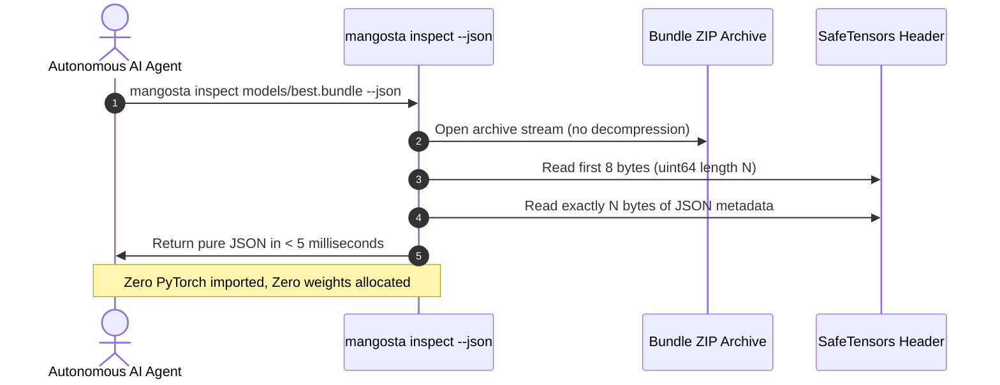

# 100% Agent-Friendly Design

> Mangosta was engineered from day one as a dual-interface library: intuitive and Pythonic for human engineers, yet deterministic, zero-allocation, and structured for autonomous AI coding agents.

Modern AI coding agents (such as Google Antigravity, Claude Code, Cursor, Codex, and OpenHands) frequently struggle with traditional MLOps tools. Opaque binary files, heavyweight background daemons, dynamic imports that swallow exceptions, and unstructured text outputs lead to high token burn, hallucinations, and out-of-memory crashes.

Mangosta solves this with **first-class agent ergonomics**.

---

## 1. Sub-5ms CLI Inspection with Zero-Allocation Header Parsing

When an agent needs to inspect a 10 GB model checkpoint, loading PyTorch into memory via `torch.load()` takes several seconds, consumes gigabytes of VRAM/RAM, and risks crashing the agent's execution environment.

Mangosta implements a pure-Python, zero-allocation SafeTensors binary header parser in `inspect_bundle`:



### Why Agents Benefit
- **Execution Speed**: Benchmarked at `< 5ms` on modern SSDs.
- **Minimal Token Usage**: Agents receive clean, structured JSON containing exact layer shapes, parameter counts, and dtypes without noisy stdout junk.
- **Zero Memory Pressure**: Agents can inspect massive foundation models without reserving GPU memory or risking OOM kills.

```bash
mangosta inspect checkpoints/epoch_10.bundle --json
```

```json
{
  "bundle_path": "checkpoints/epoch_10.bundle",
  "status": "valid",
  "family": "resnet_classifier",
  "version": "1.0.0",
  "is_checkpoint": true,
  "weights_format": "safetensors",
  "weights_sha256": "4b6a9f2...",
  "total_parameters": 11176512,
  "architecture": {
    "layers": {
      "conv1.weight": { "shape": [64, 3, 7, 7], "dtype": "F32", "num_parameters": 9408 }
    }
  }
}
```

---

## 2. Structured Error Codes with Remediation Hints

When code fails in standard libraries, stack traces often lack actionable context. Autonomous agents are left guessing how to repair the issue.

Mangosta equips every internal exception with an explicit error code and a human/agent-readable `hints` list:

```python
try:
    cls, ver = ModelRegistry.get_model_cls("vision_transformer", "2.0.0")
except ModelNotFoundError as e:
    print(e.code)   # "MODEL_FAMILY_NOT_FOUND"
    print(e.hints)  # Actionable remediation instructions
```

### Example: Architectural Collision

When an agent accidentally registers the same model family and version twice:

```text
RegistryCollisionError [MANG_REG_001]: Model family 'mlp' version '1.0.0' is already registered.
Remediation Hints:
  1. Increment the semantic version string (e.g., version='1.0.1' or version='1.1.0').
  2. If re-registering during an interactive session, pass allow_override=True.
  3. Ensure multiple files do not define conflicting @register_model decorators for the same family.
```

The agent reads the structured hint and immediately applies the correct fix on its next iteration.

---

## 3. Autonomous Context File: `.agents/mangosta.md`

Running `mangosta init <project>` automatically scaffolds an agent context instruction file at `.agents/mangosta.md`. 

This file acts as an embedded system prompt for coding agents entering the codebase, defining:
1. **Repository Layout**: Where models, configs, artifacts, and training scripts reside.
2. **Coding Standards**: Prohibition of `pickle`, strict type hints with `py.typed`, and semantic versioning rules.
3. **Execution Commands**: Verified commands for running tests (`pytest`), checking types (`mypy`), inspecting bundles (`mangosta inspect`), and serving models (`mangosta serve`).

By referencing this file, agents operate with full context and zero configuration friction.

---

## 4. Zero Background Daemons & Clean File Lifecycles

Agents frequently run in containerized sandboxes with restricted network capabilities or background process constraints.

- **No Zombie Daemons**: Mangosta does not start background supervisor daemons, Postgres instances, or Celery workers.
- **Deterministic Cleanup**: The visual analytics UI (`mangosta view`) runs in the foreground or as a child process and terminates cleanly with `SIGINT` / `SIGTERM`.
- **Pure Local IO**: All operations read and write to standard filesystem paths, making sandbox sandboxing completely friction-free.

---

## 5. Built-in Antigravity Skill Integration

Mangosta ships with a preconfigured Antigravity CLI skill under `skills/mangosta/SKILL.md`.

When developing with Google Antigravity or compatible agentic systems, the skill is automatically recognized, granting the agent:
- Deep awareness of Mangosta's public API and conventions.
- Standard recipe patterns for fast prototyping, checkpoint resumption, and production deployment.
- Recommended debugging protocols for tensor schema mismatches and ONNX export failures.
