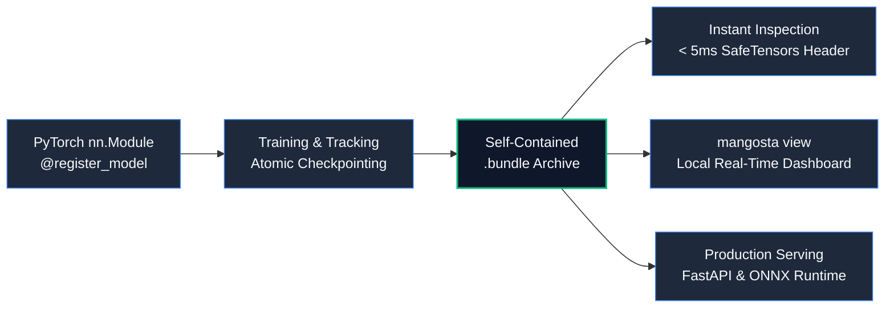

# Mangosta

> **Lightweight MLOps and Model Lifecycle Management for PyTorch.**  
> Simple by default, strict on demand. Built for humans and 100% agent-friendly.

---

```bash
pip install mangosta
```

Mangosta is an air-gapped, zero-daemon MLOps library designed for PyTorch practitioners, autonomous AI coding agents, and high-reliability production environments. It replaces heavy, brittle enterprise platforms with Unix-philosophy tooling: **plain files, SafeTensors serialization, atomic operations, and deterministic reproducibility.**



---

## Why Mangosta?

Modern MLOps often burdens machine learning engineers with container bloat, background server processes, cloud subscriptions, and unverified `pickle` checkpoints. Mangosta approaches machine learning operations from first principles:

- **100% Agent-Friendly**: Features sub-5ms inspection (`mangosta inspect <bundle> --json`) that parses binary SafeTensors headers directly with **zero PyTorch allocation** and structured error codes that supply actionable recovery hints for AI agents.
- **Zero-Pickle Security**: Weights are saved strictly in Hugging Face SafeTensors with SHA-256 cryptographic verification in `manifest.json`. Arbitrary code execution during checkpoint loading is impossible.
- **Crash-Consistent Resumption**: Uses atomic file swaps (`.tmp_*` -> `os.replace`) so power cuts or spot instance terminations never leave corrupted archives. Resumes model weights, optimizer, scheduler, AMP scaler, and 4 RNG generators deterministically.
- **Zero Background Daemons**: Visual analytics (`mangosta view`) runs as a lightweight, read-only HTTP server only when you ask for it. It leaves zero orphaned sockets, databases, or processes when terminated.
- **Production-Ready Contracts**: Built-in tensor contract validation (`infer_schema`, `validate_tensor`), FastAPI microservice scaffolding, and one-line ONNX bundling (`export_onnx_as_bundle`).

---

## 60-Second Quickstart

### 1. Register and Train a Model

```python
import torch
import torch.nn as nn
from mangosta import register_model, save_bundle, ExperimentTracker

# 1. Define architecture with semantic versioning
@register_model(family="mlp", version="1.0.0")
class MLP(nn.Module):
    def __init__(self, in_features: int = 16, out_features: int = 2):
        super().__init__()
        self.fc = nn.Linear(in_features, out_features)

    def forward(self, x: torch.Tensor) -> torch.Tensor:
        return self.fc(x)

# 2. Track metrics and validate
tracker = ExperimentTracker(experiment_name="demo", run_name="run_01")
model = MLP()
optimizer = torch.optim.AdamW(model.parameters(), lr=1e-3)
x = torch.randn(8, 16)

for epoch in range(1, 4):
    loss = model(x).sum()
    loss.backward()
    optimizer.step()
    optimizer.zero_grad()
    tracker.log_epoch(epoch, {"train_loss": loss.item()})

# 3. Save an atomic, self-contained bundle
save_bundle(
    "models/mlp.bundle",
    model=model,
    sample_input=x,
    optimizer=optimizer,
    epoch=3,
)
```

### 2. Inspect with Sub-5ms CLI

Inspect the saved model bundle instantly without loading PyTorch or allocating GPU memory:

```bash
mangosta inspect models/mlp.bundle --json
```

```json
{
  "bundle_path": "models/mlp.bundle",
  "status": "valid",
  "family": "mlp",
  "version": "1.0.0",
  "is_checkpoint": true,
  "weights_format": "safetensors",
  "weights_sha256": "4b6a...e3f8",
  "total_parameters": 34,
  "architecture": {
    "layers": {
      "fc.weight": { "shape": [2, 16], "dtype": "F32", "num_parameters": 32 },
      "fc.bias": { "shape": [2], "dtype": "F32", "num_parameters": 2 }
    }
  }
}
```

### 3. Launch the Local Analytics Dashboard

Visualize loss curves, multi-run comparisons, and temporal validation timelapses:

```bash
mangosta view
```

Open `http://127.0.0.1:8501` in your browser. The dashboard reads the local `runs/` directory dynamically, supports dark/light themes, and shuts down cleanly on `Ctrl+C`.

---

## Comparison Matrix

| Feature | Mangosta | MLflow | Weights & Biases | Plain PyTorch (`.pt`) |
| :--- | :---: | :---: | :---: | :---: |
| **Storage Architecture** | Flat files (`.bundle`, SafeTensors) | SQLite / Postgres + S3 | Cloud SaaS / MinIO | Raw pickle file |
| **External Daemons** | None | Required (`mlflow server`) | SaaS Cloud Daemon | None |
| **Agent Ergonomics** | Sub-5ms `--json`, zero-alloc header parsing | Heavy REST API / Python SDK | Proprietary API & SDK | Custom code required |
| **Security Execution** | Zero-pickle (SafeTensors only) | Pickle / Arbitrary Python | Pickle / Cloud artifacts | Pickle (`torch.load`) |
| **RNG Reproducibility** | PyTorch (CPU/CUDA) + NumPy + Python | Partial (custom logic) | Custom artifact logic | Manual implementation |
| **Air-Gapped Operation** | 100% Native | Requires manual setup | Not supported (SaaS) | Native |
| **Inference Serving** | Integrated FastAPI + ONNX Runtime | MLflow Models container | None | Custom boilerplate |

---

## Installation

Install Mangosta via `pip` or `uv`:

```bash
pip install mangosta
```

For full installation options, including ONNX runtime, FastAPI serving, and air-gapped wheel packaging, see the [Installation Guide](installation.md).
