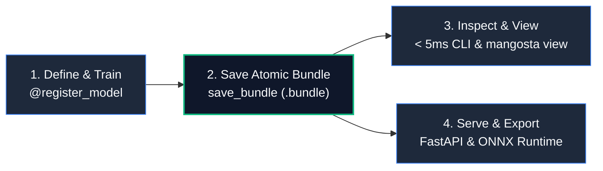

# Mangosta

> **Lightweight MLOps and Model Lifecycle Management for PyTorch.**  
> Simple by default, strict on demand. Built for humans, 100% agent-friendly.

```bash
pip install mangosta
```

Mangosta replaces heavy, server-dependent MLOps platforms with Unix-philosophy tooling: **plain files, SafeTensors serialization, atomic operations, and deterministic reproducibility.**



---

## 30-Second Workflow

### 1. Train and Save an Atomic Bundle

Decorate your model, track loss, and save an atomic `.bundle` archive with weights serialized strictly in SafeTensors:

```python
import torch
import torch.nn as nn
from mangosta import register_model, save_bundle, RunTracker

@register_model(family="mlp", version="1.0.0")
class MLP(nn.Module):
    def __init__(self, in_features: int = 16, out_features: int = 2):
        super().__init__()
        self.fc = nn.Linear(in_features, out_features)

    def forward(self, x: torch.Tensor) -> torch.Tensor:
        return self.fc(x)

# Track experiment and save self-contained bundle
with RunTracker(experiment="demo", run_name="run_01") as tracker:
    model = MLP()
    x = torch.randn(8, 16)
    tracker.log_metrics({"loss": 0.42}, step=1)
    save_bundle("models/mlp.bundle", model=model, sample_input=x)
```

### 2. Inspect Instantly (< 5ms)

Inspect the bundle without importing PyTorch or allocating memory:

```bash
mangosta inspect models/mlp.bundle --json
```

```json
{
  "family": "mlp",
  "version": "1.0.0",
  "weights_format": "safetensors",
  "weights_sha256": "4b6a...e3f8",
  "total_parameters": 34
}
```

### 3. Launch Local Dashboard

Launch the zero-daemon visual analytics viewer:

```bash
mangosta view
```

Open `http://127.0.0.1:8501` to view loss curves, run comparisons, and validation timelapses.

---

## Four Core Guarantees

=== "Zero Pickle"
    **Security by default.** Model weights are saved exclusively in Hugging Face SafeTensors with SHA-256 cryptographic verification in `manifest.json`. Arbitrary code execution during checkpoint loading is impossible.

=== "Crash Consistent"
    **Zero corrupted checkpoints.** Saves write to a process-unique temporary file (`.tmp_*`) and finalize with an atomic filesystem rename (`os.replace`). Resumes model, optimizer, scheduler, AMP scaler, and 4 RNG states deterministically.

=== "Zero Daemons"
    **No background bloat.** No background databases, no Docker requirements, and no orphaned processes. Everything is a standard file on disk.

=== "100% Agent-Friendly"
    **Built for AI coding agents.** Sub-5ms CLI inspection parses binary SafeTensors headers directly with zero PyTorch allocation. Exceptions return structured error codes with actionable remediation hints.

---

## Next Steps

<div class="grid cards" markdown>

-   :material-book-open-page-variant:{ .lg .middle } __[Philosophy & Vision](philosophy_and_vision.md)__
    
    ---
    
    Learn why Mangosta adheres to the Unix philosophy and view the comparison matrix against MLflow and W&B.

-   :material-download:{ .lg .middle } __[Installation Guide](installation.md)__
    
    ---
    
    Install with `pip`, `uv`, optional extras (`[onnx]`, `[serving]`), or offline air-gapped setup.

-   :material-robot:{ .lg .middle } __[100% Agent-Friendly](agent_friendly.md)__
    
    ---
    
    Discover sub-5ms inspection, `.agents/mangosta.md` guidelines, and Antigravity skill integration.

-   :material-code-tags:{ .lg .middle } __[Canonical Examples](examples.md)__
    
    ---
    
    Explore 4 runnable tutorials with a smooth step-by-step learning progression.

</div>
