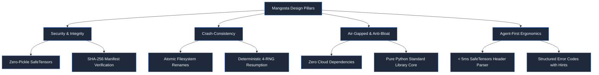

# Philosophy & Vision

> "Simple by default, strict on demand."  
> — The Mangosta Manifesto

Machine learning operations has accumulated significant architectural bloat. What began as a need to record hyperparameters and persist weights has metastasized into distributed microservice topologies, database servers, proprietary cloud services, and heavy dockerized runtimes.

**Mangosta rejects this unnecessary complexity.** It reimagines MLOps through the lens of the **Unix Philosophy**, bringing clarity, speed, security, and deterministic reliability back to the PyTorch ecosystem.

---

## The Unix Philosophy in MLOps

Mangosta adheres strictly to classical software engineering virtues:

### 1. Plain Files Over Opaque Databases
- Everything in Mangosta is a readable file on the filesystem:
  - Model bundles are standard ZIP archives containing a `manifest.json` and `model.safetensors`.
  - Experiment logs are append-only `metrics.jsonl` files.
  - Artifacts are organized hierarchically under standard directory trees.
- You can inspect, version-control with Git LFS, archive with `tar`, rsync across clusters, or inspect with `unzip -l` and `jq` using standard operating system utilities.

### 2. Composable, Machine-Readable Streams
- Programs should write text streams that other programs can parse.
- Mangosta provides pure JSON outputs via `--json` across all CLI commands. There is no ASCII art or markdown noise when interacting programmatically.
- AI agents, shell pipelines, and orchestrators (Slurm, Kubernetes, Bash) can inspect models and experiment metrics in under 5 milliseconds.

### 3. Zero-Daemon Architecture
- Traditional platforms require background servers (`mlflow server`), local database engines (SQLite locks in distributed file shares), or cloud account credentials before logging a single epoch.
- Mangosta requires **zero background processes**. When your training script finishes, no orphaned process remains.
- The visual analytics dashboard (`mangosta view`) is an on-demand, read-only HTTP viewer that launches when you want to view results and closes cleanly when you exit.

---

## Comparison Matrix

| Feature | Mangosta | MLflow | Weights & Biases | Plain PyTorch (`.pt`) |
| :--- | :---: | :---: | :---: | :---: |
| **Storage Architecture** | Flat files (`.bundle`, SafeTensors) | SQLite / Postgres + S3 | Cloud SaaS / MinIO | Raw pickle file |
| **External Daemons** | None | Required (`mlflow server`) | SaaS Cloud Daemon | None |
| **Agent Ergonomics** | Sub-5ms `--json`, zero-alloc header parsing | Heavy REST API / Python SDK | Proprietary API & SDK | Custom code required |
| **Security Execution** | Zero-pickle (SafeTensors only) | Pickle / Arbitrary Python | Pickle / Cloud artifacts | Pickle (`torch.load`) |
| **RNG Reproducibility** | PyTorch (CPU/CUDA) + NumPy + Python | Partial (custom logic) | Custom artifact logic | Manual implementation |
| **Air-Gapped Operation** | 100% Native | Requires manual setup | Not supported (SaaS) | Native |
| **Inference Serving** | Integrated FastAPI + ONNX Runtime | MLflow Models container | None | Custom boilerplate |

---

## Core Tenets

### 1. Zero-Pickle Security by Default
Python's `pickle` serialization format (the historical default for `torch.save`) executes arbitrary bytecode upon deserialization. Loading untrusted `.pt` or `.pth` files is a critical remote code execution (RCE) vector.

Mangosta enforces **Zero-Pickle execution**:
- Model weights are stored exclusively using Hugging Face SafeTensors (`model.safetensors`).
- Every archive computes a SHA-256 digest at write time, verified upon loading.
- Model architectures are decoupled from serialization and registered declaratively with `@register_model`.

### 2. Crash-Consistent Fault Tolerance
Distributed training on preemptible or spot instances frequently suffers from abrupt terminations. In standard PyTorch code, if a process dies while writing a checkpoint, the resulting checkpoint file is corrupted and unusable.

Mangosta guarantees crash-consistency:
- All bundle saves write to a process-unique temporary file (`.tmp_<pid>_<uuid>`).
- Only after weights, manifests, schemas, and auxiliary states are completely flushed and closed does Mangosta perform an atomic filesystem rename (`os.replace`).
- If your job crashes mid-write, your previous checkpoint remains valid and pristine.

### 3. Air-Gapped and Sovereign First
Mangosta is designed from the ground up for environments with zero internet connectivity:
- Hospital on-premise clusters subject to patient data sovereignty regulations (HIPAA/GDPR).
- Air-gapped defense and government research environments.
- Edge robotic devices running offline.
- High-performance computing (HPC) environments with strict egress firewalls.

Mangosta has zero mandatory cloud telemetry, zero remote tracking pings, and does not require outbound internet access at any stage of its lifecycle.

---

## What Teams Build with Mangosta

- **Solo ML Researchers & PhD Students**: Instant project scaffolding (`mangosta init`), local curve inspection with `mangosta view`, and shareable reproducible `.bundle` files.
- **Enterprise CV & NLP Teams**: Standardized internal model repositories with cryptographic SHA-256 supply-chain verification and one-command ONNX export (`export_onnx_as_bundle`).
- **Autonomous AI Coding Agents**: Machine-readable CLI (`--json`) with sub-5ms inspection, actionable error codes, and embedded guidelines (`.agents/mangosta.md`).
