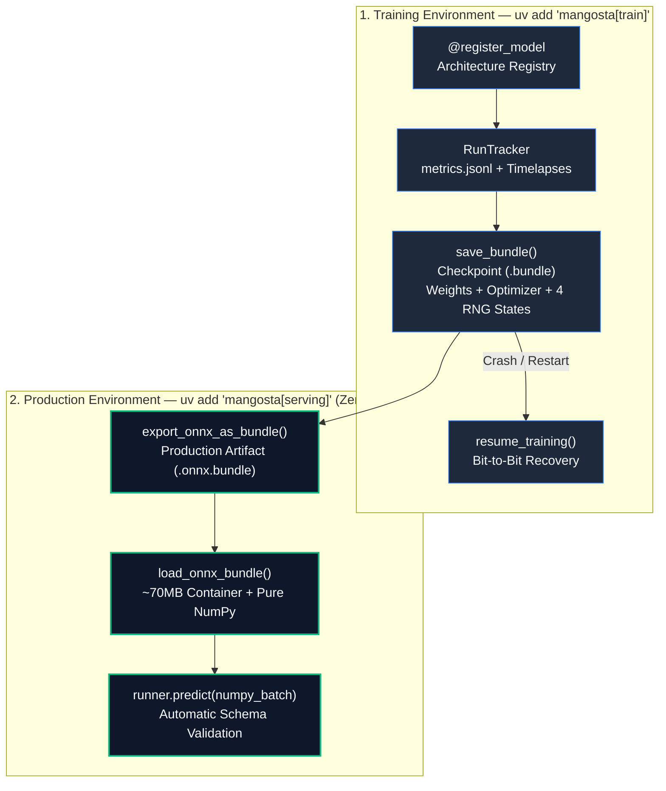

# Philosophy & Vision

> **"Simple by default, strict on demand."**  
> Mangosta is built around one practical goal: **make the transition from PyTorch training to production serving effortless, deterministic, and lightweight.**

---

## 1. The Problem in Everyday PyTorch Projects

In 80% of machine learning projects, developers hit the same three walls:

1. **Fragile Checkpoints (`.pt` / `.pth`)**: `torch.save()` relies on Python's `pickle`. If you rename a file, loading breaks. If a spot instance crashes mid-save, your file is corrupted. When you resume training, your random generators (`torch`, `cuda`, `numpy`, `python`) are out of sync.
2. **Heavy Tracking Infrastructure**: Just to see a loss curve or compare how a segmentation mask evolves across epochs, traditional tools force you to run database servers (`mlflow server`) or send private data to cloud SaaS platforms.
3. **Bloated Production Containers (`2.5GB+`)**: To serve a simple trained network in production, teams often install the entire PyTorch + CUDA runtime inside their microservice container, leading to slow cold starts and silent bugs when input shapes or `dtypes` change.

---

## 2. Mangosta's Vision: One Lifecycle, Two Environments

Mangosta separates **Training** from **Production** while keeping both connected through self-contained, cryptographically verified `.bundle` files:

---

## 3. Which Artifact Should I Use? (`.bundle` vs `.onnx.bundle`)

Understanding the three bundle modes is the key to mastering Mangosta (`examples/01_lifecycle_training_vs_production.py`):

| Artifact Type | How to Create It | What's Inside the ZIP | When to Use It |
| :--- | :--- | :--- | :--- |
| **1. Training Checkpoint** (`.bundle`) | `save_bundle(..., optimizer=opt, scheduler=sched, epoch=e)` | `manifest.json` + `model.safetensors` + `train_state.pt` (Optimizer + 4 RNGs) | Mid-training backups and exact bit-to-bit resumption after spot preemption. |
| **2. PyTorch Inference Bundle** (`.bundle`) | `save_bundle(..., sample_input=x)` *(omit optimizer)* | `manifest.json` + `model.safetensors` + `ModelSchema` | Sharing trained PyTorch models with teammates or evaluating inside PyTorch. |
| **3. Production ONNX Bundle** (`.onnx.bundle`) | `export_onnx_as_bundle(model_or_bundle, "prod.onnx.bundle", sample_input=x)` | `manifest.json` + `model.onnx` + `ModelSchema` | **Production microservices (`~70MB`)**. Runs with `load_onnx_bundle` using pure NumPy and **zero PyTorch**. |

---

## 4. The 4 Pillars of Developer Experience (DX)

### Pillar 1: Zero-Pickle SafeTensors & Contracts
Every bundle stores weights in Hugging Face **SafeTensors** (`model.safetensors`) with a SHA-256 hash and an automatically inferred `ModelSchema` (`[None, features]`, `float32`). If a production request sends shape `[4, 5]` instead of `[4, 8]`, Mangosta rejects it before execution with a clear `SchemaValidationError`.

### Pillar 2: Bit-to-Bit Deterministic Resumption
Passing `optimizer` to `save_bundle()` automatically snapshots PyTorch CPU RNG, all CUDA GPU RNGs, NumPy RNG, and Python `random`. Calling `resume_training(..., restore_rng=True)` guarantees your resumed run produces the **exact same floating-point losses** as an uninterrupted run.

### Pillar 3: Zero-Daemon Visual Tracking (`mangosta view`)
`RunTracker` writes directly to flat files (`run.json`, `metrics.jsonl`, and step-versioned validation images). When you want to inspect training curves or scrub through validation predictions epoch-by-epoch, run `uv run mangosta view`. When you press `Ctrl+C`, zero background processes remain.

### Pillar 4: 100% Agent-Friendly & Machine-Readable
AI coding agents (Antigravity, Cursor, Claude Code) can inspect any `.bundle` in **`< 5ms`** via `mangosta inspect <bundle> --json` without importing PyTorch or allocating RAM/VRAM. Every exception includes a programmatic remediation `.hint` so agents fix issues on the first try.

---

## 5. How Mangosta Compares

| Capability | **Mangosta** | **Vanilla PyTorch (`.pt`)** | **MLflow / W&B** |
| :--- | :--- | :--- | :--- |
| **Background Servers / Daemons** | **Zero** (Flat files) | Zero | Required (`mlflow server` / Cloud SaaS) |
| **Weights Serialization** | **SafeTensors + SHA-256** (Zero Pickle) | `pickle` (Arbitrary code execution risk) | Usually `pickle` + custom wrappers |
| **Bit-to-Bit RNG Recovery** | **Built-in** (CPU, CUDA, NumPy, Python) | Manual boilerplate | Manual boilerplate |
| **Pre-Inference Shape/Dtype Check** | **Automatic (`ModelSchema`)** | None (crashes inside layers) | Optional / heavy wrapper |
| **Production Container Size** | **~70MB (`mangosta[serving]`)** | ~2.5GB – 6GB | ~2.5GB – 6GB |
| **CLI Inspection Speed** | **`< 5ms` (`inspect --json`, Zero-Torch)** | Seconds (requires `torch.load`) | Seconds (requires SDK/API) |
