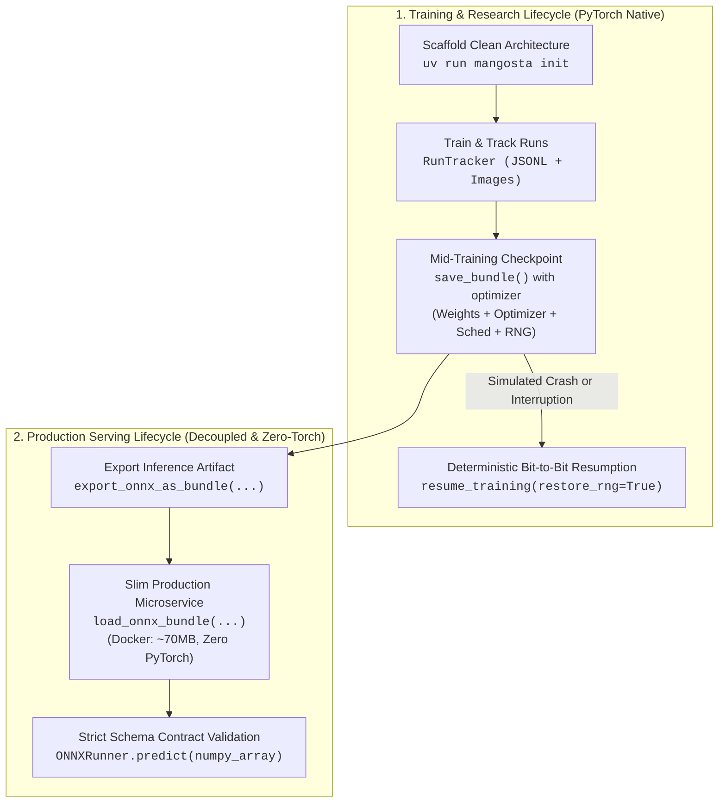

# mangosta: Agent Engineering & Architecture Guide

`mangosta` is a zero-daemon, local-first library for managing the entire PyTorch model lifecycle.
It replaces complex, fragile infrastructure (MLflow, ClearML, W&B) with direct, atomic file system operations,
formal tensor contracts, deterministic training state persistence, and slim production serving.

---

## 1. Modular Architecture & Package Responsibilities

When reading, generating, or debugging code with `mangosta`, adhere strictly to its architectural boundaries:

| Package | Responsibility | Primary APIs |
| :--- | :--- | :--- |
| **`mangosta.core`** | Immutable architecture & trainer registration, strict config & tensor I/O contracts. | `ModelRegistry`, `TrainerRegistry`, `@register_model`, `@register_trainer`, `MangostaConfig`, `load_config`, `seed_everything`, `ModelSchema`, `TensorSpec`, `infer_schema` |
| **`mangosta.engine`** | White-box PyTorch training orchestration with automated tracking, bundles, AMP & RNG resume. | `BaseTrainer` |
| **`mangosta.artifacts`** | Atomic ZIP `.bundle` creation, decoupled loading & state recovery. | `save_bundle`, `load_bundle`, `resume_training`, `read_bundle_manifest` |
| **`mangosta.tracking`** | Atomic step metrics logging, validation timelapses & reporting. | `RunTracker`, `quick_track`, `generate_report`, `start_viewer` |
| **`mangosta.export`** | Decoupled ONNX graph export with FP16 and unrolling. | `export_onnx`, `export_onnx_as_bundle` |
| **`mangosta.serving`** | Slim, zero-PyTorch microservice inference engine. | `ONNXRunner`, `load_onnx_bundle` |
| **`mangosta.cli`** | Ephemeral, machine-readable CLI commands. | `uv run mangosta init`, `inspect --json`, `view`, `report` |

All primary entrypoints are exposed at the top-level package namespace (`from mangosta import ...`).

---

## 2. Fundamental Philosophy: Training vs Production Serving

Mangosta enforces a clean separation of concerns across the model lifecycle:



### The Architectural Rule:
- **During Training**: Use standard PyTorch classes, GPU acceleration, and `RunTracker`. Save checkpoints with optimizer, scheduler, and RNG generator states captured.
- **During Serving**: Decouple from PyTorch completely. Use `.onnx.bundle` or standalone `.onnx` with `mangosta.serving.ONNXRunner`. Input arrays are validated as pure NumPy before execution, dropping container image sizes from `~2.5GB` to `~70MB`.

---

## 3. Environment & Installation Guidelines (Standard: `uv`)

All commands and execution workflows should standardize on `uv`:
- **Full Development Toolkit**: `uv add "mangosta[full]"` (installs PyTorch, SafeTensors, ONNX, and ONNX Runtime).
- **Zero-PyTorch Microservices**: `uv add "mangosta[serving]"` (installs ONNX Runtime, NumPy, PyYAML).
- **CLI Commands Execution**: Always run CLI commands through `uv run mangosta <command>` inside projects.

---

## 4. Agent Operational Rules

1. **Scaffold with Clean Architecture**:
   When asked to bootstrap a new PyTorch project, invoke `uv run mangosta init <name>`. This creates a standard tree with `configs/`, `src/`, `entrypoints/`, and `.agents/mangosta.md`.
2. **Never Bypass the Registry for Production Bundles**:
   Always register neural network architectures using `@register_model(family="<name>", version="<semver>")`. This guarantees that `load_bundle()` can reconstruct the network without hardcoded class imports in serving scripts.
3. **Respect Collision Protection**:
   `ModelRegistry.register_model()` rejects duplicate `(family, version)` pairs with `RegistryCollisionError`. Never overwrite versions silently; bump the semantic version (e.g., `1.0.0` -> `1.1.0`) unless explicitly instructed via `allow_override=True`.
4. **Consistent Bundle Family & Version Alignment**:
   When calling `save_bundle()`, pass explicit `family` and `version` or rely on the registered model class. Mangosta auto-aligns the bundle manifest to match the registered model family and resolves normalized alphanumeric variations (e.g. `sensor_classifier` <-> `sensorclassifier`).
5. **Tracking Standard: Always Generate `RunTracker`**:
   AI agents MUST default to generating `with RunTracker(experiment=..., run_name=...) as run:` for all production scripts, pipelines, and training loops.
   - `RunTracker` is the primary domain class with native `__enter__` and `__exit__` dunder methods, explicit typing, and full IDE autocompletion.
   - `quick_track` is preserved as a shorthand alias for 1-line interactive prototypes.
6. **Log Step Metrics and Temporal Validation Samples**:
   - `run.log_metrics({"train_loss": ...}, step=step)`: Appends atomically to `metrics.jsonl`.
   - `run.log_validation_sample(sample_id, prediction, input_image, ground_truth, step=step)`: Versions images across steps for the `uv run mangosta view` temporal scrubber.
7. **Automatic Checkpoints vs Final Inference Bundles**:
   - Checkpoints: Pass `optimizer`, `scheduler`, and/or `scaler` to `save_bundle()`. Mangosta automatically marks the bundle as a checkpoint (`manifest["is_checkpoint"] = True`) and packages `train_state.pt` containing exact RNG seeds (PyTorch CPU/CUDA, NumPy, Python).
   - Inference bundles: Omit optimizer/scheduler to produce a lightweight, deployment-ready bundle containing only SafeTensors weights, manifest, and contract schema.
8. **Verify Dynamic Batch Dimensions in Contracts**:
   Always pass `sample_input` to `save_bundle()` or use `infer_schema(model, sample_input)`. Dimension 0 is automatically converted to dynamic batching (`None`).
9. **Decouple Production Serving**:
   For microservices and edge deployment, export via `export_onnx_as_bundle` or `export_onnx`. In production environments without PyTorch, import from `mangosta.serving` using `load_onnx_bundle` and `ONNXRunner`.
10. **Machine-Readable Inspection in `< 5ms`**:
    When inspecting `.bundle` archives programmatically, run `uv run mangosta inspect <bundle> --json`. It parses little-endian binary SafeTensors headers directly with zero tensor allocations, saving thousands of LLM tokens.
11. **Zero Background Daemons**:
    `uv run mangosta view` uses standard library `http.server`. It starts ephemerally and cleans up on shutdown. Never try to spin up background daemons, Postgres, or Redis.

---

## 5. Canonical Code Patterns

### Pattern 1: Architecture Registration & Contract Definition
```python
import torch
import torch.nn as nn
from mangosta import register_model

@register_model(family="vision_classifier", version="1.0.0")
class VisionClassifier(nn.Module):
    def __init__(self, in_channels: int = 3, num_classes: int = 10) -> None:
        super().__init__()
        self.encoder = nn.Sequential(
            nn.Conv2d(in_channels, 32, kernel_size=3, padding=1),
            nn.BatchNorm2d(32),
            nn.ReLU(),
            nn.AdaptiveAvgPool2d((1, 1)),
        )
        self.head = nn.Linear(32, num_classes)

    def forward(self, x: torch.Tensor) -> torch.Tensor:
        return self.head(self.encoder(x).flatten(1))
```

### Pattern 2: Atomic Experiment Tracking with Validation Timelapses
```python
from mangosta import RunTracker

with RunTracker(experiment="image_classification", run_name="baseline_adamw") as run:
    # Audit data lineage with SHA-256 fingerprint
    data_hash = run.set_dataset("data/train_split.parquet")
    run.log_params({"lr": 1e-3, "batch_size": 32, "optimizer": "AdamW"})

    for epoch in range(epochs):
        # ... training step ...
        run.log_metrics({"train/loss": loss.item(), "train/acc": acc}, step=epoch)

        # Log temporal validation predictions for the live scrubber in uv run mangosta view
        run.log_validation_sample(
            sample_id="patient_scan_01",
            prediction=pred_mask_np,
            input_image=raw_scan_np,
            ground_truth=gt_mask_np,
            step=epoch,
        )
```

### Pattern 3: Deterministic Checkpoint & Exact Bit-to-Bit Resumption
```python
import torch
from mangosta import save_bundle, resume_training, ModelRegistry

# 1. Save mid-training crash-consistent checkpoint
save_bundle(
    output_path="checkpoints/epoch_05.bundle",
    model=model,
    family="vision_classifier",
    version="1.0.0",
    init_args={"in_channels": 3, "num_classes": 10},
    sample_input=torch.randn(1, 3, 224, 224),
    optimizer=optimizer,
    scheduler=scheduler,
    epoch=5,
    step=2500,
    metrics={"val_loss": 0.245},
)

# 2. Resuming deterministically after crash
fresh_model = ModelRegistry.build("vision_classifier", version="1.0.0", in_channels=3, num_classes=10)
fresh_opt = torch.optim.AdamW(fresh_model.parameters(), lr=1e-3)
fresh_sched = torch.optim.lr_scheduler.StepLR(fresh_opt, step_size=5)

# Restores weights, optimizer state, scheduler step, AND exact CPU/CUDA/NumPy RNG seeds
resume_state = resume_training(
    bundle_path="checkpoints/epoch_05.bundle",
    model=fresh_model,
    optimizer=fresh_opt,
    scheduler=fresh_sched,
    restore_rng=True,
)
next_epoch = resume_state.epoch + 1
```

### Pattern 4: Decoupled PyTorch Inference with Contract Enforcement
```python
import torch
from mangosta import load_bundle

bundle = load_bundle("checkpoints/model_final.bundle")
# Validates shape (including dynamic batching) and dtype before execution
test_input = torch.randn(8, 3, 224, 224)
predictions = bundle.predict(test_input)
```

### Pattern 5: Slim Zero-PyTorch Production Serving (`~70MB` Docker Container)
```python
import numpy as np
from mangosta.export import export_onnx_as_bundle
from mangosta.serving import load_onnx_bundle

# 1. Export trained model as an ONNX bundle
export_onnx_as_bundle(
    bundle_or_model="checkpoints/model_final.bundle",
    output_path="deploy/model.onnx.bundle",
    sample_input=torch.randn(1, 3, 224, 224),
)

# 2. In production container (ZERO PyTorch installed):
runner = load_onnx_bundle("deploy/model.onnx.bundle")
# Validates NumPy array shape/dtype against ModelSchema contract
pure_numpy_input = np.random.randn(4, 3, 224, 224).astype(np.float32)
output = runner.predict(pure_numpy_input)
print(f"Inference output shape: {output.shape}")
```

### Pattern 6: Machine-Readable Inspection & Offline Reports
```bash
# Programmatic inspection in < 5ms (returns structured JSON payload)
uv run mangosta inspect checkpoints/model_final.bundle --json

# Generate standalone offline HTML report
uv run mangosta report experiments/image_classification/baseline_adamw -o report.html

# Launch local browser visualizer with validation scrubber
uv run mangosta view
```

### Pattern 7: Declarative Training with `BaseTrainer`, `TrainerRegistry` & `MangostaConfig`
```python
from mangosta import (
    BaseTrainer,
    ModelRegistry,
    TrainerRegistry,
    load_config,
    register_trainer,
)

@register_trainer(family="vision_classifier", version="1.0.0")
class VisionTrainer(BaseTrainer):
    def training_step(self, batch):
        x, y = batch
        return self.criterion(self.model(x), y)

    def validation_step(self, batch):
        x, y = batch
        preds = self.model(x)
        return {"val_loss": self.criterion(preds, y)}

# Strict YAML config loading (catches typos with 'Did you mean...?' & logs defaults)
cfg = load_config("configs/exp_baseline.yaml")
model = ModelRegistry.build_from_config(cfg)
trainer = TrainerRegistry.build_from_config(cfg, model=model)
trainer.fit(train_loader, val_loader, resume_from=None)
```

---

## 6. Structured Exception Reference & Remediation

| Exception | Root Cause | Programmatic Remediation (`hint`) |
| :--- | :--- | :--- |
| `ConfigError` | Unknown YAML key (typo) or invalid type in `MangostaConfig`. | Fix the misspelled key suggested in the error message or move custom fields under `data:` / `custom:`. |
| `RegistryCollisionError` | Attempted to register duplicate `(family, version)`. | Bump semantic version (e.g. `1.1.0`) or pass `allow_override=True`. |
| `ModelNotFoundError` | Requested architecture not found in `ModelRegistry`. | Ensure the module containing `@register_model` is imported. |
| `TrainerNotFoundError` | Requested trainer not found in `TrainerRegistry`. | Ensure the module containing `@register_trainer` is imported. |
| `SchemaValidationError` | Input tensor or NumPy array violates schema contract. | Verify array dimensions against `bundle.schema.inputs`. |
| `ResumeStateError` | Attempted to resume from a bundle lacking `train_state.pt`. | Verify bundle was saved with `optimizer=` to capture training state. |
| `BundleCorruptedError` | Missing archive files or SHA-256 hash mismatch. | Archive integrity compromised; re-export or restore from verified source. |
| `ImportError` | Attempted to use PyTorch-only function in slim environment. | Use `mangosta.serving` primitives or install PyTorch (`uv add 'mangosta[full]'`). |
